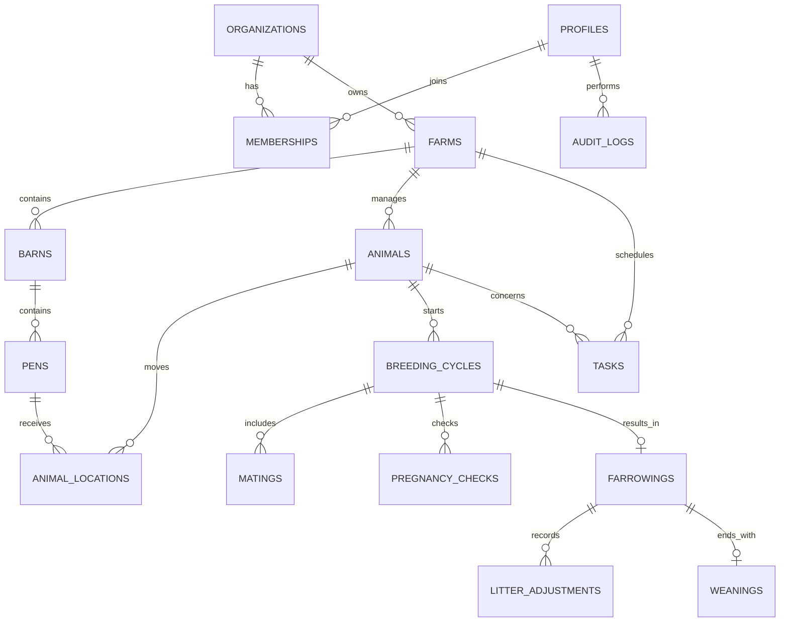

# 모돈 번식농장 데이터 모델 초안

## 설계 기준

- 외부에 노출되는 주요 ID는 시간 순서가 유지되는 UUIDv7을 우선 검토한다. 확장 지원 여부를 확인하기 전까지 마이그레이션에는 확정하지 않는다.
- 시간은 `timestamptz`, 달력상의 날짜만 필요한 값은 `date`, 두수는 음수를 허용하지 않는 정수로 저장한다.
- 모든 외래 키 컬럼과 RLS 조건 컬럼에 사용 패턴에 맞는 인덱스를 둔다.
- 생산 이벤트는 취소 시 삭제하지 않고 `voided_at`, `voided_by`, `void_reason`을 기록한다.
- `organization_id`와 `farm_id`를 업무 테이블에 명시해 RLS와 조회를 단순화한다.
- 새 테이블의 Data API 권한은 자동 공개를 기대하지 않고 필요한 역할에 명시적으로 부여한다.

## 관계 개요

## 테이블 초안

### 권한과 농장

| 테이블 | 핵심 컬럼 | 설명 |
| --- | --- | --- |
| `profiles` | `id -> auth.users`, `display_name`, `phone` | 로그인 사용자 프로필 |
| `organizations` | `id`, `name`, `created_by` | 여러 농장을 묶는 소유 조직 |
| `memberships` | `organization_id`, `profile_id`, `role`, `status` | 조직 역할과 초대 상태 |
| `farms` | `id`, `organization_id`, `name`, `timezone` | 실제 농장 |
| `farm_memberships` | `farm_id`, `profile_id`, `role` | 사용자의 담당 농장과 권한 |
| `barns` | `id`, `farm_id`, `name`, `purpose` | 교배사·임신사·분만사 등 |
| `pens` | `id`, `barn_id`, `name`, `capacity` | 돈방/스톨 |

### 번식돈과 위치

| 테이블 | 핵심 컬럼 | 설명 |
| --- | --- | --- |
| `animals` | `id`, `farm_id`, `animal_no`, `sex`, `animal_type`, `status`, `parity`, `birth_date`, `entry_date`, `exit_date` | 모돈·후보돈·웅돈 마스터 |
| `animal_identifiers` | `animal_id`, `type`, `value`, `is_primary` | 이각·전자태그·등록번호 |
| `animal_locations` | `animal_id`, `pen_id`, `started_at`, `ended_at` | 위치 이력 |
| `animal_status_events` | `animal_id`, `from_status`, `to_status`, `occurred_at`, `reason` | 상태 변경 이력 |

`animals.status`는 빠른 목록 조회용 현재값이며, 원본 변경 근거는 이벤트 테이블에 남긴다.

### 번식 사이클

| 테이블 | 핵심 컬럼 | 설명 |
| --- | --- | --- |
| `breeding_cycles` | `id`, `farm_id`, `sow_id`, `cycle_no`, `started_at`, `status`, `expected_farrow_date`, `closed_at` | 한 번의 번식 시도부터 이유까지의 묶음 |
| `matings` | `cycle_id`, `mated_at`, `sequence_no`, `method`, `boar_id`, `semen_code` | 한 사이클 내 1회 이상 교배 |
| `pregnancy_checks` | `cycle_id`, `checked_at`, `result`, `method` | 임신진단 및 재검 |
| `farrowings` | `cycle_id`, `farrowed_at`, `total_born`, `born_alive`, `stillborn`, `mummified`, `other_count` | 분만과 최초 복 두수 |
| `litter_adjustments` | `farrowing_id`, `occurred_at`, `type`, `delta_count`, `reason` | 포유 중 폐사 등 두수 증감 |
| `weanings` | `farrowing_id`, `weaned_on`, `piglet_count`, `total_weight_kg`, `average_weight_kg` | 복의 최종 이유 |

현재 포유두수는 `born_alive + 두수 조정 합계 - 이유두수`로 계산한다. 폐사처럼 두수가 줄어드는 기록은 음수 `delta_count`로 남긴다. 초기에는 원본 이벤트에서 계산하고, 성능 문제가 확인될 때만 캐시 컬럼이나 집계 테이블을 도입한다.

### 작업과 감사

| 테이블 | 핵심 컬럼 | 설명 |
| --- | --- | --- |
| `tasks` | `farm_id`, `animal_id`, `cycle_id`, `type`, `due_at`, `status`, `assignee_id`, `completed_at` | 예정 작업과 완료 |
| `audit_logs` | `organization_id`, `farm_id`, `actor_id`, `table_name`, `record_id`, `action`, `before_data`, `after_data`, `created_at` | 중요 변경 감사 이력 |

## 핵심 무결성 규칙

1. 같은 농장에서 활성 개체의 `animal_no`는 중복될 수 없다.
2. 모돈 한 마리에 동시에 열린 번식 사이클은 하나만 허용한다.
3. 한 사이클에는 유효한 분만 기록 하나만 존재한다.
4. 한 분만에는 유효한 최종 이유 기록 하나만 존재한다.
5. 분만 총산자수는 세부 두수의 합과 같아야 한다.
6. 두수 조정 후 현재 포유두수는 0보다 작을 수 없다.
7. 이벤트의 모돈, 사이클, 농장 ID는 모두 같은 소유 범위를 가리켜야 한다.
8. 완료 또는 취소된 번식 사이클에는 새 교배 기록을 추가할 수 없다.

위 규칙 중 단일 행으로 검증 가능한 것은 `check`/`unique` 제약으로, 여러 행을 확인해야 하는 것은 짧은 트랜잭션 안의 DB 함수나 트리거로 보장한다.

## RLS 접근 모델

| 역할 | 읽기 | 입력/수정 | 설정/사용자 관리 |
| --- | --- | --- | --- |
| 소유자 | 조직 내 전체 농장 | 전체 | 가능 |
| 관리자 | 담당 농장 | 담당 농장 전체 | 농장 설정 가능 |
| 작업자 | 담당 농장 | 생산 기록과 작업 완료 | 불가 |
| 컨설턴트 | 허용된 담당 농장 | 기본 불가 | 불가 |

정책은 단순히 `to authenticated`만 사용하지 않고, `(select auth.uid())`와 `farm_memberships`의 활성 멤버십을 함께 확인한다. 복잡한 멤버십 확인 함수가 필요하면 비공개 스키마에 두고 호출 권한과 검색 경로를 제한한다.

## 주요 조회와 인덱스 후보

- `animals (farm_id, status, animal_no)` — 농장별 활성 모돈 목록/검색
- `breeding_cycles (farm_id, status, expected_farrow_date)` — 분만 예정 목록
- `breeding_cycles (sow_id) where closed_at is null` — 열린 사이클 하나 보장
- `tasks (farm_id, status, due_at)` — 오늘/지연 작업
- `animal_locations (animal_id, ended_at)` — 현재 위치
- 모든 외래 키 컬럼 — 조인 및 삭제/정정 작업

정확한 인덱스는 실제 쿼리와 실행 계획을 확인한 후 확정한다.

## 첫 KPI 정의

| 지표 | 계산 기준 |
| --- | --- |
| 교배복수 | 기간 내 첫 교배가 기록된 번식 사이클 수 |
| 분만율 | 교배 후 분만한 복수 ÷ 분만 결과가 확정된 교배복수 × 100 |
| 복당 총산 | 총산자수 합 ÷ 분만복수 |
| 복당 생존산자 | 생존자돈수 합 ÷ 분만복수 |
| 복당 이유두수 | 이유두수 합 ÷ 이유복수 |
| 이유 전 폐사율 | `포유 중 폐사두수 ÷ 생존자돈수 × 100` |
| 이유 후 첫 교배 간격 | 이유일에서 다음 사이클 첫 교배일까지의 평균 일수 |

분만율의 분모는 아직 분만 예정일이 지나지 않은 교배를 제외해 기간 말 왜곡을 방지한다.
